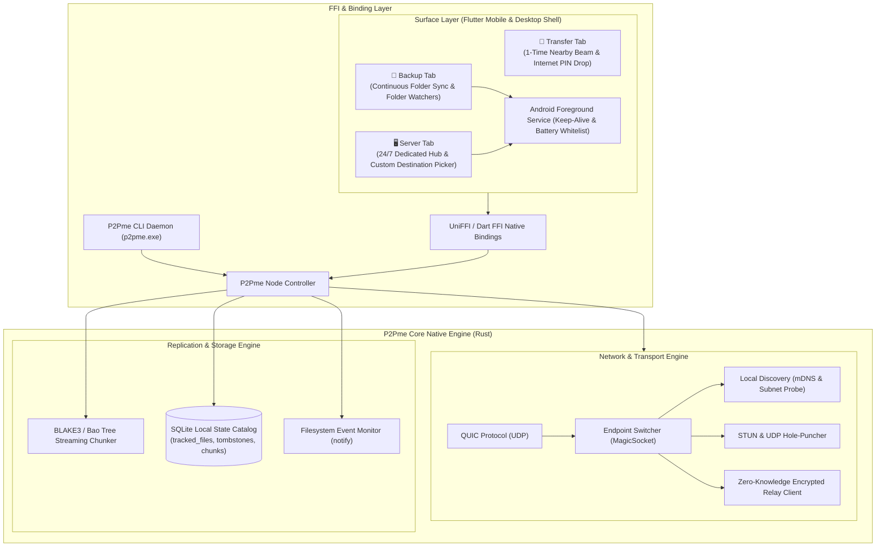
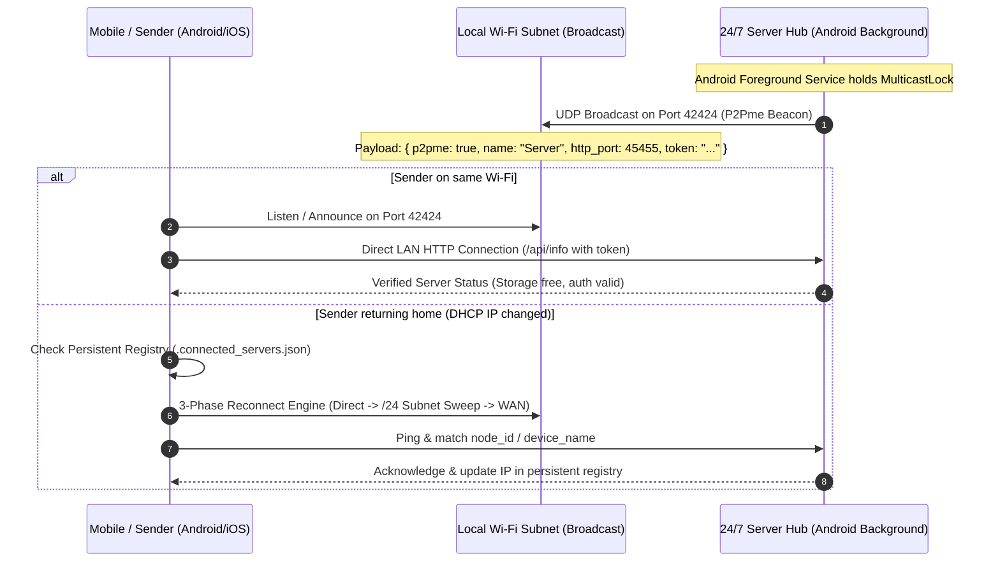
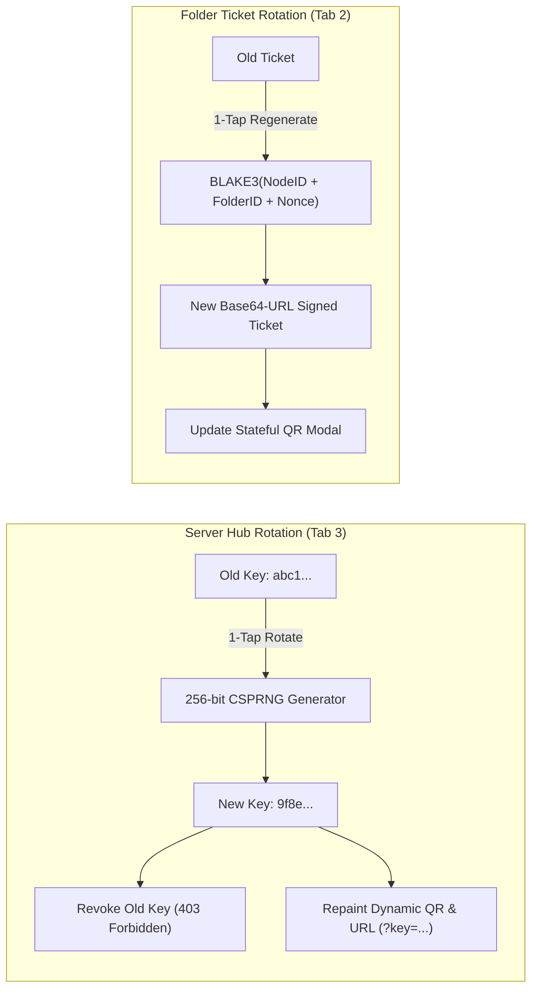
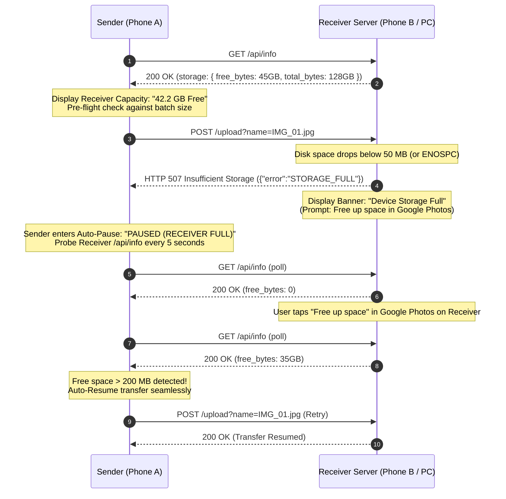
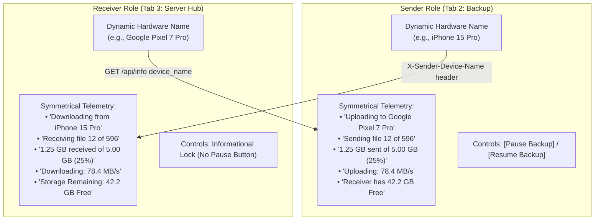
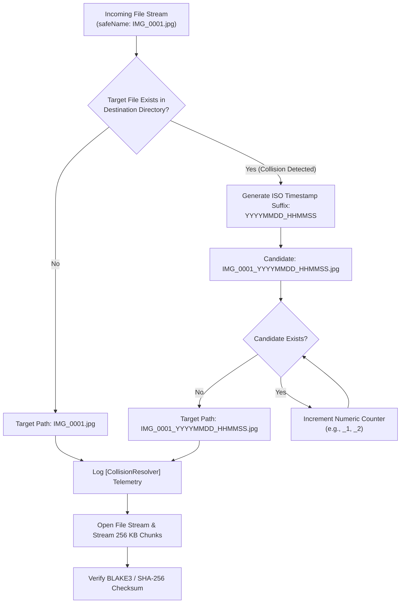
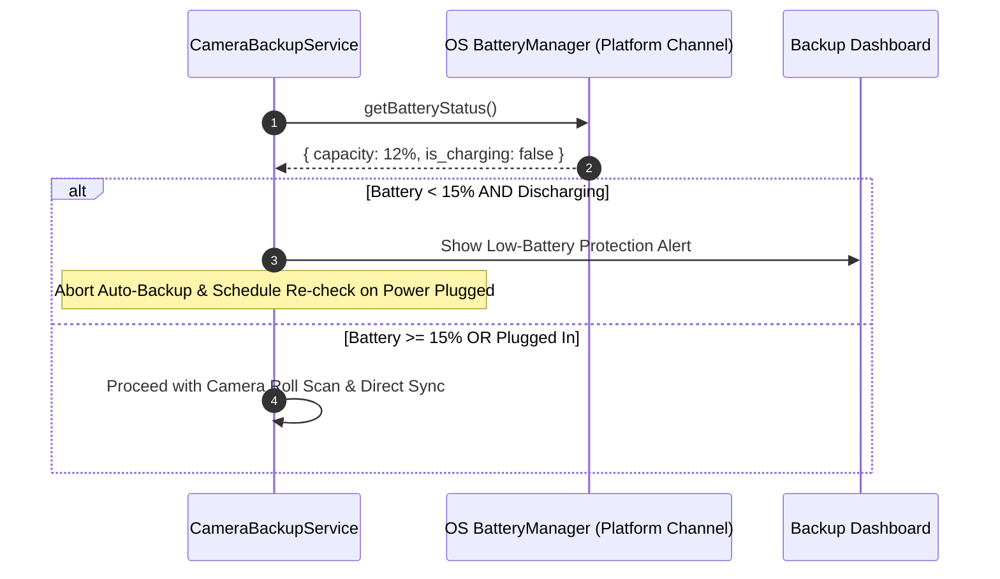

# P2Pme System Architecture

## 1. Executive Overview

**P2Pme** is a high-performance, decentralized, end-to-end encrypted peer-to-peer data replication and transfer system. It connects devices directly across local networks (LAN) and the global internet (WAN) with zero third-party data custody.

---

## 2. System Architecture Layers

---

## 3. The 5-Tier Multi-Network Transport Hierarchy

To guarantee 100% connectivity between any two devices globally—whether across physical cables, local Wi-Fi, cellular networks, or restricted corporate firewalls—P2Pme uses an adaptive multi-tier transport hierarchy:

| Tier | Network Path | Mechanism | Latency / Speed | Offline? |
| :--- | :--- | :--- | :--- | :--- |
| **Tier 0** | **Direct USB Cable** | CDC-NCM / RNDIS USB Tethering / Hotspot point-to-point link | Sub-millisecond / Full USB wire-speed (100–480+ Mbps) | **Yes** (100% offline, 0% Wi-Fi) |
| **Tier 1** | **Direct LAN** | mDNS + Multicast UDP discovery (`MulticastLock`) | Sub-millisecond / Full LAN wire-speed (1–10 Gbps) | **Yes** (100% offline) |
| **Tier 2** | **Internet Direct (STUN + Edge Rendezvous)** | RFC 5389 STUN NAT traversal + Cloudflare edge rendezvous | Internet ping / Full broadband & 5G speed | No (Zero cloud custody) |
| **Tier 3** | **Encrypted Mesh / Remote WAN** | Tailscale / WireGuard / IPv6 / Configured Remote Host | Internet ping / Full ISP & 5G line speed | No |

### Connection Fallback Lifecycle
1. **Physical Cable First (Tier 0):** If a USB-C or Lightning cable connects the two devices (with USB tethering enabled on mobile), P2Pme discovers the virtual CDC-NCM/RNDIS adapter and locks to the physical link-local socket, bypassing Wi-Fi entirely.
2. **Local Wi-Fi Next (Tier 1):** When two devices pair via an authentication ticket or QR code, both nodes announce themselves to the local subnet via mDNS and UDP broadcast beacons. If both peers are on the same Wi-Fi, the connection locks to the LAN address for maximum bandwidth.
3. **Internet Direct via STUN & Edge Rendezvous (Tier 2):** When peers are on different networks (e.g. mobile 5G to home Wi-Fi), the node queries public STUN servers (`stun.l.google.com:19302`) to discover its external WAN socket. Drop candidates are announced to the Cloudflare edge rendezvous (`/api/drop/announce`), allowing the receiver to resolve candidates and initiate direct peer-to-peer QUIC transfer.
4. **Encrypted Mesh & Remote WAN (Tier 3):** If carrier NAT blocks inbound UDP packets, peers route through private Tailscale mesh (`100.x.x.x`) or configured DDNS domain.

---

## 4. Storage, Chunking & State Reconciliation

### A. BLAKE3 & Bao-Tree Verified Streaming
* Large files are partitioned into verified content-addressed blocks.
* Each block is hashed using **BLAKE3**, offering hashing speeds exceeding 4 GB/s.
* Out-of-order block streaming allows receiving devices to verify each block's cryptographic proof immediately upon arrival, enabling parallelized multi-stream downloads directly into pre-allocated sparse storage.

### B. High-Speed Mtime-Cached Scanning & Safe Tombstones
* **Mtime Scanning Cache:** Directories are scanned against SQLite state; unmodified files matching both `mtime_ns` and `file_size` reuse cached BLAKE3 hashes, speeding up directory indexing by 100x and eliminating CPU/battery exhaustion during background replication.
* **Tombstone Hash Matching:** Inbound tombstones are verified against local content hashes before deleting any local asset. If a local file has been modified or differs from the tombstone's deleted hash, deletion is refused.
* **Automatic Pruning:** Tombstones older than 30 days are automatically garbage-collected.

### C. SQLite Metadata Catalog
The local catalog tracks state persistently using SQLite with Write-Ahead Logging (WAL):
* `tracked_files`: Records file path, content hash, size, modification timestamp (`mtime`), and synchronization state.
* `tombstones`: Records deletions. When a file is removed, its tombstone propagates across peers so the file is deleted on other devices instead of being treated as missing and re-downloaded.
* `block_manifest`: Maps individual block ranges to hashes for delta-level transfers.

---

## 5. Security Model

1. **Cryptographic Identity:**
   Every device generates an ed25519 keypair on first run. The public key serves as the permanent Device Node ID.
2. **End-to-End Encryption:**
   All wire communications are encrypted using mutual TLS 1.3 / Noise protocol over QUIC. No plaintext headers or metadata leave the device.
3. **Capability-Based Access:**
   * **Read-Write Ticket:** Full permission to push and pull modifications.
   * **Read-Only Ticket:** Can receive data and updates, but cannot sign or push file modifications.
   * **Pairing Expiration:** Temporary pairing codes / QR codes with configurable timeouts.

---

## 6. Distribution, Updates & Deployment Model

P2Pme is architected to operate without mandatory app store monopolies, supporting frictionless peer distribution and transparent updates:

### A. Web PWA (iOS & Desktop Browsers)
* **Hosting:** Cloudflare Pages edge network (`https://p2pme.pages.dev`).
* **Auto-Updates & Offline-First:** Service Worker (`sw.js`) with `self.skipWaiting()` and `self.clients.claim()` using a **Cache-First (offline-first)** caching strategy with versioned cache (`p2pme-v20`). Static assets are served instantly from local cache for full offline operation. Dynamic API routes (`/api/`) and upload endpoints (`/upload`) bypass the cache for direct network streaming. When a new version is deployed to Cloudflare Pages edge, updated assets are retrieved and the cache automatically purges obsolete versions.

### B. Windows Portable Application
* **Zero-Installation Architecture:** Distributed as a standalone zip archive (`P2Pme-Windows.zip`) containing `p2pme_app.exe` (Flutter desktop shell), `p2pme.exe` (Rust native engine daemon), and required runtime DLLs.
* **No Elevated Privileges:** Runs entirely in user space without requiring administrator permissions, registry modification, or system hooks.
* **Responsive Desktop Viewport:** Optimized desktop layout centered to 880px content width with ergonomic navigation.

### C. Android Native Application
* **Distribution:** Direct release APK (`P2Pme.apk` targeted at `arm64-v8a` and universal ABI).
* **In-App Update Checker:** On startup or user request, the application queries `https://p2pme.pages.dev/version.json`. If a higher `version_code` is detected, a non-intrusive banner notifies the user with a 1-tap download and update link.

### D. iOS Native Application & AltStore Source
* **Distribution:** Genuine macOS-compiled `.ipa` (`P2Pme.ipa` bundle ID `net.p2pme.p2pmeApp`).
* **AltStore / SideStore Integration:** Official repository source published at `https://p2pme.pages.dev/altstore-source.json`. Supports 1-tap in-app install, source updates, and background profile refreshes.
* **macOS Cloud CI/CD:** Because compiling iOS AOT Mach-O binaries requires Xcode and macOS, cloud automation via GitHub Actions (`.github/workflows/build-release.yml`) builds and packages the genuine IPA on `macos-latest` runners whenever `main` is updated.

---

## 7. Nearby Wi-Fi Discovery, Persistent Registry & Pairing

1. **UDP Broadcast Beacon & MulticastLock (Single Authoritative Switch):** Nodes operating as Receiver or 24/7 Server Hub broadcast discovery beacons on UDP port `42424`. The Server Hub engine is **OFF by default** on all platforms upon installation or role initialization (`_isServerEnabled = false`). Only when the user explicitly turns the Server toggle switch ON does the app bind to port `45455`, begin UDP discovery broadcasting, and start the Android foreground keep-alive service (`P2PmeSyncService` with `WakeLock`, `WifiLock`, and `MulticastLock`). This setting is persisted in `.p2pme_config.json`, ensuring the server stays active always across app launches and device reboots until the user manually toggles it OFF. When toggled OFF, sockets close, the background daemon cleanly stops (zero background battery drain), and beacons cease. All redundant or conflicting switches have been eliminated.
2. **Persistent Connected Servers Registry:** Senders persist all successfully paired servers to `.connected_servers.json`. Unlike transient scan caches, this registry survives app restarts, device reboots, and network changes.
3. **Dynamic 3-Phase Reconnection Engine:** When a sender leaves and returns home (or when the home router DHCP assigns a new IP to the server), the sender executes a systematic 3-phase reconnection:
   * **Phase 1 (Direct Ping):** Tests the last-known IP via `GET /api/info` with the saved pairing token.
   * **Phase 2 (Subnet Sweep):** Concurrently sweeps the local `/24` subnet in batches of 25 nodes, querying `/api/info` and matching by persistent `node_id` or device name. When found, the registry automatically updates the IP and saves to disk.
   * **Phase 3 (Remote WAN / Mesh Fallback):** If configured with a Tailscale/WireGuard IP or DDNS host, falls back to probing the remote WAN endpoint.
4. **Immediate 1-Tap Connection & Manual Reconnect:** Senders display all known servers in both the Quick Beam (Transfer) and Backup tabs with live status indicators, a 1-tap "Send Here" beam button, and a dedicated "Reconnect / Ping" button.

---

## 8. Zero-Conflict Cryptographic Key & Ticket Rotation

To prevent credential stagnation, unauthorized hub access, or pairing ticket collisions, P2Pme implements an on-demand cryptographic rotation architecture:

1. **Server Hub Secret (Tab 3):**
   * Generated using cryptographically secure random values (`Random.secure()` / `crypto.getRandomValues()`).
   * Encoded as 256-bit hex strings attached as query parameters (`?key=...`) to server URLs and embedded in QR codes.
   * Rotating the key immediately revokes previous access: any upload attempt or WebDrop connection presenting the superseded key is rejected with HTTP 403 Forbidden.
2. **Folder Pairing Tickets (Tab 2):**
   * Encodes a signed, base64-url pairing ticket containing folder ID, node identity, access permissions, and a timestamp nonce.
   * 1-tap regeneration re-derives the authentication token via BLAKE3, rendering prior tickets obsolete and updating the dynamic QR code in place.
3. **Camera QR Viewfinder & Client Pairing (Tab 2):**
   * The sender device (iOS, Android, or PC) opens the native camera viewfinder (`mobile_scanner` via AVFoundation on iOS, CameraX on Android) or selects a QR image.
   * Scanning the server's QR code extracts the host IP, HTTP port (45455), and secret token (`?key=...`).
   * The client probes the server's `/api/info` endpoint, establishes the paired state, saves credentials to `.paired_server` for automated persistence, and triggers camera roll auto-backup.

---

## 9. Real-Time Transfer Speed & Ingestion Telemetry

P2Pme incorporates symmetric high-frequency sampling and batch metadata headers for wire-speed network observability:

1. **Sender-Side Measurement & Batch Telemetry (`CameraBackupService` & Direct Beam):**
   * Emits chunks across HTTP streams while maintaining a 200–250ms sampling timer (`Stopwatch`).
   * Evaluates instantaneous wire throughput: `speedMBps = (deltaBytes / deltaSeconds) / (1024 * 1024)`.
   * Drives real-time UI meters displaying upload throughput (`Uploading: 64.8 MB/s`), batch percentage (`25%`), total bytes transferred against total batch (`1.25 GB / 5.00 GB`), current file progress (`IMG_1234.JPG • 4.5 MB / 10.0 MB`), and sender-exclusive Pause / Resume controls.
   * Transmits batch state headers (`X-File-Index`, `X-Total-Files`, `X-Batch-Total-Bytes`, `X-Batch-Bytes-Sent`) with every chunk stream.
2. **Receiver-Side Measurement (24/7 Server Hub & Ingestion Engine):**
   * Streams incoming HTTP `/upload` request byte chunks directly into target files (`DCIM/Camera` or user-defined destination).
   * Computes incoming ingress velocity every 200ms based on chunk bytes ingested against total file content length (`Downloading: 64.8 MB/s`).
   * Parses batch headers to display live download progress: active file index out of total files (`Downloading file 12 of 596`), total batch bytes received out of total batch (`Received 1.25 GB of 5.00 GB • 25%`), and current file percentage.
   * Surfaces active receiving progress strictly on Tab 3 (Server), keeping Tab 2 dedicated to outbound backup without clutter.
   * **Sender-Exclusive Control (Receiver Lock):** In Server Mode, the receiver operates as a dedicated automated ingestion hub; transfers and pause/resume states are strictly managed by the initiating sender to prevent desynchronization or conflicting two-way transfers.

---

## 10. Direct USB-to-USB Cable Transfer & Cellular Persistence Architecture

### A. Point-to-Point USB Cable Networking (CDC-NCM / RNDIS)
* When two devices are connected directly via a physical USB-C or Lightning cable (e.g. Phone-to-Phone, Phone-to-PC, or PC-to-PC), enabling USB Tethering on Android or Personal Hotspot via USB on iOS initializes a standard IEEE 802.3 Ethernet-over-USB network interface (`rndis0`, `usb0`, `ncm0`, or `cdc0`).
* The OS automatically configures an isolated point-to-point link-local subnet (typically `192.168.42.0/24` on Android or `172.20.10.0/28` on iOS).
* P2Pme binds to wildcard socket `0.0.0.0:45455`, allowing incoming traffic over the physical USB network interface without modifying host routing tables.
* Interface inspection automatically flags physical cable adapters, surfacing an active `⚡ USB Cable Connected` status badge in the UI and routing traffic across the physical wire at speeds up to 110–480+ MB/s with zero wireless interference or packet drop.

### B. Paired Server Persistence Across Cellular (5G/LTE) Transitions
* When an iPhone or Android device leaves the home Wi-Fi network, previous implementations that evaluated pairing solely based on live LAN UDP broadcast presence (`_nearbyPeers.isNotEmpty`) inadvertently wiped the paired server card, resetting the UI to "No Backup Server Connected".
* In P2Pme v1.1.0+, pairing state is written synchronously to local disk storage (`.paired_server`) storing the server's Node ID, Device Name, LAN IP, LAN Port, WAN Endpoint (if configured), and authentication secret token.
* On app reboot or cellular handoff, the UI retains the paired server card with a clear connection indicator:
  - `✓ Connected (Wi-Fi)`: Active LAN connection.
  - `⚡ Connected (USB Cable)`: Direct physical wire link.
  - `🌐 Connected (Mesh / WAN)`: Active Tailscale / WireGuard / Port-forwarded endpoint.
  - `⏳ Waiting for connection / Cellular`: Server offline or peer is on mobile cellular data without an open WAN/Mesh route. Includes an instant 1-tap "Ping/Reconnect" button.

---

## 11. Receiver Storage Capacity Negotiation & Out-of-Space Protocol (HTTP 507)

1. **Native Storage Telemetry:** Servers query real-time filesystem metrics (`StatFs` on Android, `resourceValues` on iOS) and publish available space in `/api/info`. Senders visualize destination capacity before initiating transfers (`Server Storage: 42.2 GB Free`).
2. **Graceful Out-of-Space Protocol (HTTP 507):** If disk space is exhausted during ingestion, the server aborts writing, deletes partial chunks, returns `HTTP 507 Insufficient Storage`, and displays a device full banner.
3. **Automated Polling & Resume Loop:** The sender transitions to `serverStorageFull`, pauses the upload stream without desynchronizing state, and queries the receiver's `/api/info` every 5 seconds (capped at 5 minutes to prevent infinite loops). As soon as the user clears space on the receiver (e.g. via Google Photos "Free up device storage"), the sender automatically detects the freed capacity and resumes transfer from the exact interrupted item.

---

## 12. Dynamic Device Naming & Symmetrical Role Isolation

1. **Native OS Identity Extraction:** Device names are retrieved dynamically via platform channels (`Settings.Global.DEVICE_NAME` on Android, `UIDevice.current.name` on iOS, `COMPUTERNAME` on Windows) and passed through UDP beacons and `X-Sender-Device-Name` HTTP headers.
2. **Symmetrical User Clarity:** Senders always see upload speeds and sent metrics directed at the specific receiver; receivers always see download speeds and received metrics originating from the specific sender.
3. **Sender-Exclusive Pause Control:** In Server Mode, the receiver functions as an automated ingestion daemon. Senders retain exclusive control over pausing and resuming backups to eliminate two-way state conflicts.

---

## 13. Non-Destructive File Collision Resolution Pipeline

1. **Historical Immutability:** P2Pme treats landed files as immutable historical records. Incoming transfers with matching names are never allowed to silently truncate or overwrite existing files.
2. **Deterministic Timestamping:** Collisions are resolved using `_resolveUniqueFilePath`, which splits the filename into base and extension and injects `_<YYYYMMDD>_<HHMMSS>`, followed by a monotonic counter in high-concurrency conditions.
3. **Rust & Flutter Symmetry:** The collision resolution pipeline is implemented symmetrically across both native Dart (`_resolveUniqueFilePath`) and the core Rust replication engine (`crates/p2pme-core/src/drop.rs`).

---

## 14. Dedicated Destination Folder Selection & Headless Configuration Architecture

1. **Explicit Pre-Flight Ingestion Path Selection:** On the Receiver screen, users can inspect their active save destination and trigger a native directory picker to select any local path (internal storage, SD card, external drive).
2. **Persistent Default State:** Users can toggle "Set as default destination", which synchronizes the preference into `.p2pme_config.json`.
3. **Two-Tier Configuration Fallback for Headless Hubs:**
   * **Tier 1 (OS Documents Sandbox):** Primary storage path (`/data/data/net.p2pme.p2pme_app/files/` on Android, `$HOME/Documents/` on iOS).
   * **Tier 2 (External Shared Storage):** `/storage/emulated/0/Download/P2Pme/.p2pme_config.json` allows system administrators and automated scripts to provision server roles, destination paths, and device names headlessly without requiring root access or UI interaction.

---

## 15. Multi-Stream Ingestion Architecture (ActiveReceiverSession)

1. **State Isolation:** In legacy implementations, global transfer variables (`_receivingFileName`, `_receivingSpeedMBps`) created race conditions when multiple devices beamed files simultaneously.
2. **Session Thread Encapsulation:** In P2Pme v1.2.2+, each inbound transfer stream is tracked within an isolated `ActiveReceiverSession` struct containing:
   * `sessionId`: Unique 128-bit session identifier.
   * `senderName`: Dynamic hardware name of the transmitting peer.
   * `senderIp`: Network socket address.
   * `fileName`: Name of the file currently in-flight.
   * `bytesReceived` & `totalBytes`: Byte counters for the current asset.
   * `speedMBps`: Low-pass smoothed wire-speed transfer metric.
3. **Aggregated Dashboard Telemetry:** The Receiver Hub calculates total aggregate wire throughput across all active sessions (`_calculateAggregatedReceivingSpeedMBps`), providing an accurate real-time dashboard of server utilization.

---

## 16. Low-Battery Auto-Backup Protection Guard

1. **Discharge Threshold:** Auto-sync is blocked if battery capacity is strictly below 15% and `is_charging` is false.
2. **Manual Override Warning:** If a user initiates a heavy manual camera roll backup while under 15% battery, the UI presents a cautionary confirmation dialog advising them to connect a charger before proceeding.
