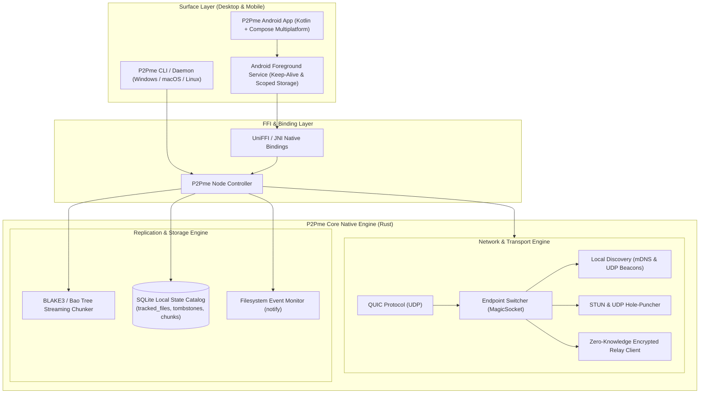

# P2Pme System Architecture

## 1. Executive Overview

**P2Pme** is a high-performance, decentralized, end-to-end encrypted peer-to-peer data replication and transfer system. It connects devices directly across local networks (LAN) and the global internet (WAN) with zero third-party data custody.

---

## 2. System Architecture Layers

---

## 3. The 4-Tier Multi-Network Transport

To guarantee 100% connectivity between any two devices globally, P2Pme uses an adaptive multi-tier transport hierarchy:

| Tier | Network Path | Mechanism | Latency / Speed | Offline? |
| :--- | :--- | :--- | :--- | :--- |
| **Tier 1** | **Direct LAN** | mDNS + Multicast UDP discovery | Sub-millisecond / Full LAN wire-speed (1–10 Gbps) | **Yes** (100% offline) |
| **Tier 2** | **Direct WAN (Router)** | UPnP / NAT-PMP port mapping | Internet ping / Full ISP line speed | No |
| **Tier 3** | **Direct WAN (Punched)** | STUN + UDP Hole Punching | Direct UDP path / Full ISP line speed | No |
| **Tier 4** | **Encrypted Relay** | DERP packet forwarder | Proxied / Bandwidth capped by relay | No |

### Connection Fallback Lifecycle
1. When two devices pair via an authentication ticket or QR code, both nodes announce themselves to the local subnet via mDNS while simultaneously contacting STUN.
2. If both peers are on the same Wi-Fi, the connection locks to the LAN address for maximum bandwidth.
3. If peers are on separate networks, STUN probes public IP/port candidates and initiates simultaneous UDP hole punching.
4. If a carrier-grade symmetric NAT (such as mobile 5G) blocks the direct hole punch, both peers establish encrypted sessions with a DERP relay node. The relay sees only encrypted bytes (TLS 1.3 / Noise protocol) and cannot inspect content.

---

## 4. Storage, Chunking & State Reconciliation

### A. BLAKE3 & Bao-Tree Verified Streaming
* Large files are partitioned into verified content-addressed blocks.
* Each block is hashed using **BLAKE3**, offering hashing speeds exceeding 4 GB/s.
* Out-of-order block streaming allows receiving devices to verify each block's cryptographic proof immediately upon arrival, enabling parallelized multi-stream downloads directly into pre-allocated sparse storage.

### B. SQLite Metadata Catalog
The local catalog tracks state persistently using SQLite with Write-Ahead Logging (WAL):
* `tracked_files`: Records file path, content hash, size, modification timestamp (`mtime`), and synchronization state.
* `tombstones`: Records deletions. When a file is removed, its tombstone propagates across peers so the file is deleted on other devices instead of being treated as missing and re-downloaded.
* `block_manifest`: Maps individual block ranges to hashes for delta-level transfers.

---

## 5. Security Model

1. **Cryptographic Identity:**
   Every device generates an ed25519 keypair on first run. The public key serves as the permanent Device Node ID.
2. **End-to-End Encryption:**
   All wire communications are encrypted using mutual TLS 1.3 / Noise protocol over QUIC. No plaintext headers or metadata leave the device.
3. **Capability-Based Access:**
   * **Read-Write Ticket:** Full permission to push and pull modifications.
   * **Read-Only Ticket:** Can receive data and updates, but cannot sign or push file modifications.
   * **Pairing Expiration:** Temporary pairing codes / QR codes with configurable timeouts.

