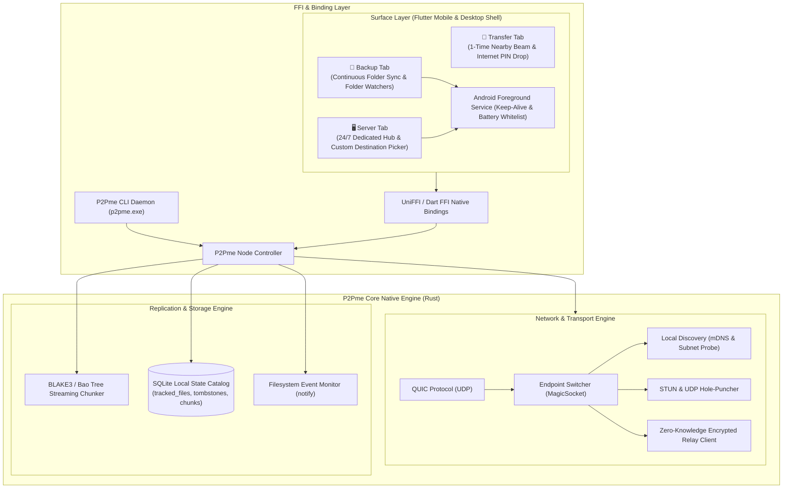
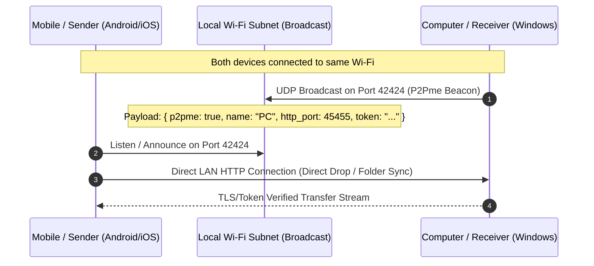
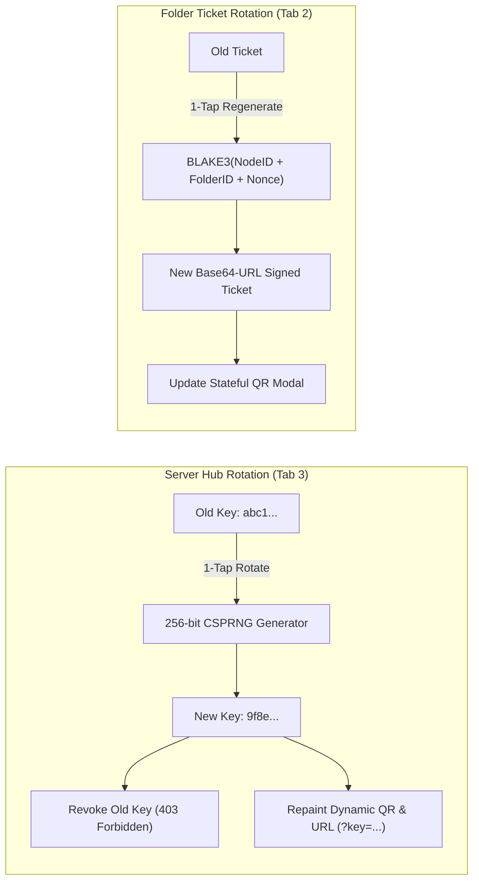

# P2Pme System Architecture

## 1. Executive Overview

**P2Pme** is a high-performance, decentralized, end-to-end encrypted peer-to-peer data replication and transfer system. It connects devices directly across local networks (LAN) and the global internet (WAN) with zero third-party data custody.

---

## 2. System Architecture Layers

---

## 3. The 5-Tier Multi-Network Transport Hierarchy

To guarantee 100% connectivity between any two devices globally—whether across physical cables, local Wi-Fi, cellular networks, or restricted corporate firewalls—P2Pme uses an adaptive multi-tier transport hierarchy:

| Tier | Network Path | Mechanism | Latency / Speed | Offline? |
| :--- | :--- | :--- | :--- | :--- |
| **Tier 0** | **Direct USB Cable** | CDC-NCM / RNDIS USB Tethering / Hotspot point-to-point link | Sub-millisecond / Full USB wire-speed (100–480+ Mbps) | **Yes** (100% offline, 0% Wi-Fi) |
| **Tier 1** | **Direct LAN** | mDNS + Multicast UDP discovery | Sub-millisecond / Full LAN wire-speed (1–10 Gbps) | **Yes** (100% offline) |
| **Tier 2** | **Direct WAN / Mesh** | Tailscale / WireGuard / IPv6 / Router Port Forward | Internet ping / Full ISP & 5G line speed | No |
| **Tier 3** | **Direct WAN (Punched)** | STUN + UDP Hole Punching | Direct UDP path / Full ISP line speed | No |
| **Tier 4** | **Encrypted Relay** | DERP packet forwarder / Zero-Knowledge Relay | Proxied / Bandwidth capped by relay | No |

### Connection Fallback Lifecycle
1. **Physical Cable First (Tier 0):** If a USB-C or Lightning cable connects the two devices (with USB tethering enabled on mobile), P2Pme discovers the virtual CDC-NCM/RNDIS adapter and locks to the physical link-local socket, bypassing Wi-Fi entirely.
2. **Local Wi-Fi Next (Tier 1):** When two devices pair via an authentication ticket or QR code, both nodes announce themselves to the local subnet via mDNS and UDP broadcast beacons. If both peers are on the same Wi-Fi, the connection locks to the LAN address for maximum bandwidth.
3. **Mesh & Remote WAN Failover (Tier 2):** When a sender switches from home Wi-Fi to cellular (5G/LTE), local subnet pings fail. The client automatically fails over to the paired node's WAN/Mesh address (e.g. Tailscale IP or public domain) configured in the pairing ticket or manual remote dialog.
4. **STUN & Hole Punching (Tier 3):** If peers are on separate uncoordinated networks, STUN probes public IP/port candidates and initiates simultaneous UDP hole punching.
5. **Encrypted Relay (Tier 4):** If carrier-grade symmetric NAT (CGNAT) on mobile data blocks direct hole punches, peers communicate through an encrypted DERP relay session where data is protected by Noise/TLS 1.3.

---

## 4. Storage, Chunking & State Reconciliation

### A. BLAKE3 & Bao-Tree Verified Streaming
* Large files are partitioned into verified content-addressed blocks.
* Each block is hashed using **BLAKE3**, offering hashing speeds exceeding 4 GB/s.
* Out-of-order block streaming allows receiving devices to verify each block's cryptographic proof immediately upon arrival, enabling parallelized multi-stream downloads directly into pre-allocated sparse storage.

### B. SQLite Metadata Catalog
The local catalog tracks state persistently using SQLite with Write-Ahead Logging (WAL):
* `tracked_files`: Records file path, content hash, size, modification timestamp (`mtime`), and synchronization state.
* `tombstones`: Records deletions. When a file is removed, its tombstone propagates across peers so the file is deleted on other devices instead of being treated as missing and re-downloaded.
* `block_manifest`: Maps individual block ranges to hashes for delta-level transfers.

---

## 5. Security Model

1. **Cryptographic Identity:**
   Every device generates an ed25519 keypair on first run. The public key serves as the permanent Device Node ID.
2. **End-to-End Encryption:**
   All wire communications are encrypted using mutual TLS 1.3 / Noise protocol over QUIC. No plaintext headers or metadata leave the device.
3. **Capability-Based Access:**
   * **Read-Write Ticket:** Full permission to push and pull modifications.
   * **Read-Only Ticket:** Can receive data and updates, but cannot sign or push file modifications.
   * **Pairing Expiration:** Temporary pairing codes / QR codes with configurable timeouts.

---

## 6. Distribution, Updates & Deployment Model

P2Pme is architected to operate without mandatory app store monopolies, supporting frictionless peer distribution and transparent updates:

### A. Web PWA (iOS & Desktop Browsers)
* **Hosting:** Cloudflare Pages edge network (`https://p2pme.pages.dev`).
* **Auto-Updates:** Service Worker (`sw.js`) with `self.skipWaiting()` and `self.clients.claim()` using a **Network-First** caching strategy. When a user opens the web app or iOS Home Screen PWA, updated assets are retrieved instantly in the background without user intervention.

### B. Windows Portable Application
* **Zero-Installation Architecture:** Distributed as a standalone zip archive (`P2Pme-Windows.zip`) containing `p2pme_app.exe` (Flutter desktop shell), `p2pme.exe` (Rust native engine daemon), and required runtime DLLs.
* **No Elevated Privileges:** Runs entirely in user space without requiring administrator permissions, registry modification, or system hooks.
* **Responsive Desktop Viewport:** Optimized desktop layout centered to 880px content width with ergonomic navigation.

### C. Android Native Application
* **Distribution:** Direct release APK (`P2Pme.apk` targeted at `arm64-v8a` and universal ABI).
* **In-App Update Checker:** On startup or user request, the application queries `https://p2pme.pages.dev/version.json`. If a higher `version_code` is detected, a non-intrusive banner notifies the user with a 1-tap download and update link.

### D. iOS Native Application & AltStore Source
* **Distribution:** Genuine macOS-compiled `.ipa` (`P2Pme.ipa` bundle ID `net.p2pme.p2pmeApp`).
* **AltStore / SideStore Integration:** Official repository source published at `https://p2pme.pages.dev/altstore-source.json`. Supports 1-tap in-app install, source updates, and background profile refreshes.
* **macOS Cloud CI/CD:** Because compiling iOS AOT Mach-O binaries requires Xcode and macOS, cloud automation via GitHub Actions (`.github/workflows/build-release.yml`) builds and packages the genuine IPA on `macos-latest` runners whenever `main` is updated.

---

## 7. Nearby Wi-Fi Discovery & Pairing

1. **UDP Broadcast Beacon:** Nodes on the local Wi-Fi subnet broadcast discovery packets on UDP port `42424` containing node name, endpoint, and dynamic session token.
2. **Immediate 1-Tap Connection:** Nearby devices appear instantly in the UI with signal and IP metadata. Tapping connects directly via LAN wire-speed.
3. **Dynamic IP Tolerance:** Device IP addresses (e.g., `192.168.x.x`) assigned by DHCP can change dynamically; the beacon protocol re-advertises new network endpoints automatically without requiring manual re-configuration.

---

## 8. Zero-Conflict Cryptographic Key & Ticket Rotation

To prevent credential stagnation, unauthorized hub access, or pairing ticket collisions, P2Pme implements an on-demand cryptographic rotation architecture:

1. **Server Hub Secret (Tab 3):**
   * Generated using cryptographically secure random values (`Random.secure()` / `crypto.getRandomValues()`).
   * Encoded as 256-bit hex strings attached as query parameters (`?key=...`) to server URLs and embedded in QR codes.
   * Rotating the key immediately revokes previous access: any upload attempt or WebDrop connection presenting the superseded key is rejected with HTTP 403 Forbidden.
2. **Folder Pairing Tickets (Tab 2):**
   * Encodes a signed, base64-url pairing ticket containing folder ID, node identity, access permissions, and a timestamp nonce.
   * 1-tap regeneration re-derives the authentication token via BLAKE3, rendering prior tickets obsolete and updating the dynamic QR code in place.
3. **Camera QR Viewfinder & Client Pairing (Tab 2):**
   * The sender device (iOS, Android, or PC) opens the native camera viewfinder (`mobile_scanner` via AVFoundation on iOS, CameraX on Android) or selects a QR image.
   * Scanning the server's QR code extracts the host IP, HTTP port (45455), and secret token (`?key=...`).
   * The client probes the server's `/api/info` endpoint, establishes the paired state, saves credentials to `.paired_server` for automated persistence, and triggers camera roll auto-backup.

---

## 9. Real-Time Transfer Speed & Ingestion Telemetry

P2Pme incorporates symmetric high-frequency sampling and batch metadata headers for wire-speed network observability:

1. **Sender-Side Measurement & Batch Telemetry (`CameraBackupService` & Direct Beam):**
   * Emits chunks across HTTP streams while maintaining a 200–250ms sampling timer (`Stopwatch`).
   * Evaluates instantaneous wire throughput: `speedMBps = (deltaBytes / deltaSeconds) / (1024 * 1024)`.
   * Drives real-time UI meters displaying upload throughput (`Uploading: 64.8 MB/s`), batch percentage (`25%`), total bytes transferred against total batch (`1.25 GB / 5.00 GB`), current file progress (`IMG_1234.JPG • 4.5 MB / 10.0 MB`), and sender-exclusive Pause / Resume controls.
   * Transmits batch state headers (`X-File-Index`, `X-Total-Files`, `X-Batch-Total-Bytes`, `X-Batch-Bytes-Sent`) with every chunk stream.
2. **Receiver-Side Measurement (24/7 Server Hub & Ingestion Engine):**
   * Streams incoming HTTP `/upload` request byte chunks directly into target files (`DCIM/Camera` or user-defined destination).
   * Computes incoming ingress velocity every 200ms based on chunk bytes ingested against total file content length (`Downloading: 64.8 MB/s`).
   * Parses batch headers to display live download progress: active file index out of total files (`Downloading file 12 of 596`), total batch bytes received out of total batch (`Received 1.25 GB of 5.00 GB • 25%`), and current file percentage.
   * Surfaces active receiving cards across both Tab 3 (Server) and Tab 2 (Backup).
   * **Sender-Exclusive Control (Receiver Lock):** In Server Mode, the receiver operates as a dedicated automated ingestion hub; transfers and pause/resume states are strictly managed by the initiating sender to prevent desynchronization or conflicting two-way transfers.

---

## 10. Direct USB-to-USB Cable Transfer & Cellular Persistence Architecture

### A. Point-to-Point USB Cable Networking (CDC-NCM / RNDIS)
* When two devices are connected directly via a physical USB-C or Lightning cable (e.g. Phone-to-Phone, Phone-to-PC, or PC-to-PC), enabling USB Tethering on Android or Personal Hotspot via USB on iOS initializes a standard IEEE 802.3 Ethernet-over-USB network interface (`rndis0`, `usb0`, `ncm0`, or `cdc0`).
* The OS automatically configures an isolated point-to-point link-local subnet (typically `192.168.42.0/24` on Android or `172.20.10.0/28` on iOS).
* P2Pme binds to wildcard socket `0.0.0.0:45455`, allowing incoming traffic over the physical USB network interface without modifying host routing tables.
* Interface inspection automatically flags physical cable adapters, surfacing an active `⚡ USB Cable Connected` status badge in the UI and routing traffic across the physical wire at speeds up to 110–480+ MB/s with zero wireless interference or packet drop.

### B. Paired Server Persistence Across Cellular (5G/LTE) Transitions
* When an iPhone or Android device leaves the home Wi-Fi network, previous implementations that evaluated pairing solely based on live LAN UDP broadcast presence (`_nearbyPeers.isNotEmpty`) inadvertently wiped the paired server card, resetting the UI to "No Backup Server Connected".
* In P2Pme v1.1.0+, pairing state is written synchronously to local disk storage (`.paired_server`) storing the server's Node ID, Device Name, LAN IP, LAN Port, WAN Endpoint (if configured), and authentication secret token.
* On app reboot or cellular handoff, the UI retains the paired server card with a clear connection indicator:
  - `✓ Connected (Wi-Fi)`: Active LAN connection.
  - `⚡ Connected (USB Cable)`: Direct physical wire link.
  - `🌐 Connected (Mesh / WAN)`: Active Tailscale / WireGuard / Port-forwarded endpoint.
  - `⏳ Waiting for connection / Cellular`: Server offline or peer is on mobile cellular data without an open WAN/Mesh route. Includes an instant 1-tap "Ping/Reconnect" button.

