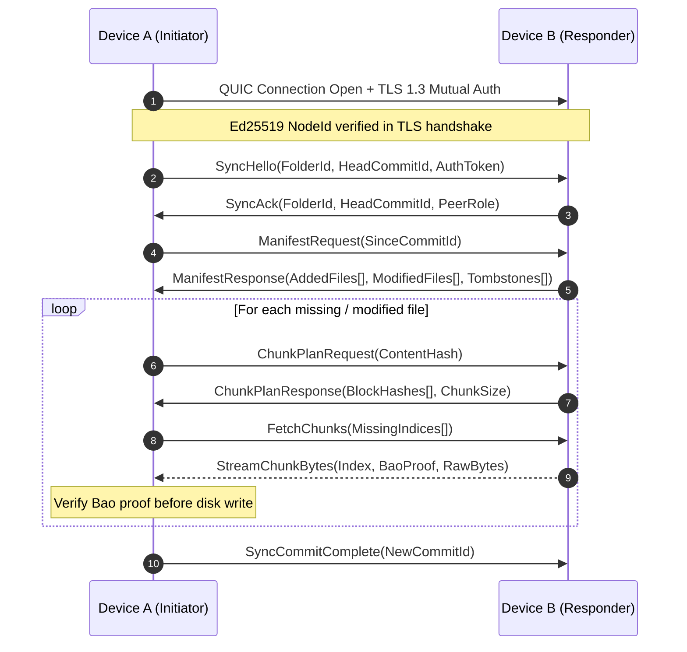

# P2Pme Wire Protocol & Data Specification

## 1. Node Identity & Addressing

Each P2Pme node is identified by a 32-byte Ed25519 Public Key:

```text
NodeId: ed25519_pubkey (Base32 encoded, 52 characters)
Example: k3d2m4p9q7x8w2z1...
```

---

## 2. Pairing Ticket Specification

Pairing between two devices (via QR code, clipboard string, or deep link) uses a compact serialized ticket:

```json
{
  "version": 1,
  "node_id": "z4k8...public_key",
  "folder_id": "uuid4_folder_identifier",
  "access": "read_write",
  "direct_addresses": [
    "192.168.1.50:11223",
    "203.0.113.195:45210"
  ],
  "relay_url": "https://relay.p2pme.net/derp",
  "auth_token": "hmac_sha256_shared_secret",
  "expires_at": 1795000000
}
```

* `access`: `"read_write"` or `"read_only"`.
* `direct_addresses`: Discovered LAN and STUN public socket candidates.
* `auth_token`: Ephemeral token for initial mutual handshake.

---

## 3. SQLite Local State Catalog Schema

```sql
PRAGMA journal_mode = WAL;
PRAGMA synchronous = NORMAL;

-- Tracked files in local managed folders
CREATE TABLE IF NOT EXISTS tracked_files (
    id INTEGER PRIMARY KEY AUTOINCREMENT,
    folder_id TEXT NOT NULL,
    relative_path TEXT NOT NULL,
    content_hash BLOB NOT NULL,
    file_size INTEGER NOT NULL,
    mtime_ns INTEGER NOT NULL,
    is_directory BOOLEAN NOT NULL DEFAULT 0,
    sync_status TEXT NOT NULL DEFAULT 'synced',
    updated_at INTEGER NOT NULL,
    UNIQUE(folder_id, relative_path)
);

-- Tombstones for deleted files (prevents resurrection across peers)
CREATE TABLE IF NOT EXISTS tombstones (
    folder_id TEXT NOT NULL,
    relative_path TEXT NOT NULL,
    deleted_hash BLOB NOT NULL,
    deleted_at INTEGER NOT NULL,
    deleted_by_node TEXT NOT NULL,
    PRIMARY KEY (folder_id, relative_path)
);

-- Content chunk manifest for delta replication
CREATE TABLE IF NOT EXISTS chunk_manifest (
    content_hash BLOB NOT NULL,
    chunk_index INTEGER NOT NULL,
    chunk_hash BLOB NOT NULL,
    offset INTEGER NOT NULL,
    length INTEGER NOT NULL,
    PRIMARY KEY (content_hash, chunk_index)
);

-- Connected peer registry
CREATE TABLE IF NOT EXISTS known_peers (
    node_id TEXT PRIMARY KEY,
    device_name TEXT NOT NULL,
    last_seen_address TEXT,
    last_handshake INTEGER,
    connection_type TEXT -- 'lan', 'wan_direct', 'relay'
);
```

---

## 4. Replication Session Handshake



---

## 5. Mobile Background Execution Strategy

1. **Foreground Service:** Uses Android `FOREGROUND_SERVICE_DATA_SYNC` with an ongoing system notification showing transfer progress.
2. **Wi-Fi SSID Filter:** Configurable setting to restrict heavy transfers only when connected to designated home/office SSIDs.
3. **Power Management:** Automatically pauses delta index hashing when battery drops below 20% unless plugged into AC power.

---

## 6. Folder Lifecycle & Server Hub Routing

### A. Folder Removal / Detachment Semantics
* When a user removes a synchronized folder from Tab 2 (Backup), `P2PBridge.instance.stopWatcher(folderId)` cleanly releases native file watchers.
* **Disk Safety Guarantee:** Local files and directories are **never** deleted from disk when unlinking a folder.
* Paired nodes treat folder detachment as a clean peer unbind; tombstones are **not** broadcast, ensuring other devices also keep their copies intact.

### B. 24/7 Server Hub & Custom Destination
* When a device operates as a 24/7 Backup Server (Tab 3), it accepts incoming WebDrop uploads and continuous backup streams.
* Incoming payloads are routed to the user's custom `_receiveDestination` path (e.g., `/storage/emulated/0/Download/P2Pme` or a custom user-created directory), rather than an immutable root folder.
* Hub credentials (IP socket, 6-digit PIN, master secret key, and dynamic QR code) allow authorized devices to pair across LAN and WAN.

---

## 7. Dynamic Key & Ticket Wire Specification

### A. Server Hub Secret Wire Authentication
When connecting to a 24/7 Hub over HTTP or WebSockets:
```http
POST /upload?key=5f3d8a9e01bc47... HTTP/1.1
Host: 192.168.1.100:45455
X-P2Pme-Key: 5f3d8a9e01bc47...
Content-Type: multipart/form-data
```
* **Validation:** The server compares the supplied `key` parameter against its active in-memory and persistent secret `_hubSecretKey`.
* **Constant-Time Comparison:** Key verification uses constant-time byte comparisons to prevent timing side-channel attacks.
* **Revocation Response:** If the secret key does not match (or has been regenerated), the server immediately returns:
```json
HTTP/1.1 403 Forbidden
Content-Type: application/json

{
  "error": "Forbidden: Invalid or revoked server secret key",
  "code": "AUTH_REVOKED"
}
```

### C. QR Code Payload & Client Pairing Handshake
When scanned by the client camera in Tab 2 (Backup):
1. **Server QR Code Schema:**
```text
http://<host>:<port>?key=<256-bit_hex_token>
```
2. **Client Parsing Sequence:**
   * Extracts IPv4 / domain address, port (defaults to 45455), and `key` authorization token.
   * Dispatches `GET /api/info` with connection timeout of 4 seconds.
   * If server responds with valid P2Pme metadata (`"p2pme": true`), client marks the peer as `isPaired: true` and associates `authToken`.
   * Client persists connection parameters to local configuration (`.paired_server`) and initiates immediate background camera sync.

### B. Folder Pairing Ticket Serialization
Folder tickets are encoded as compact Base64-URL strings:
```text
p2pme://folder?v=1&node=<NODE_ID>&folder=<FOLDER_ID>&access=rw&token=<BLAKE3_HASH>&ts=<TIMESTAMP>
```
* `token`: Derived from `BLAKE3(SecretSeed || FolderID || TimestampNonce)`.
* `ts`: Generation epoch timestamp in seconds.
* Upon regeneration, the old `SecretSeed` nonce is replaced, immediately causing subsequent verification attempts with older tokens to fail.

