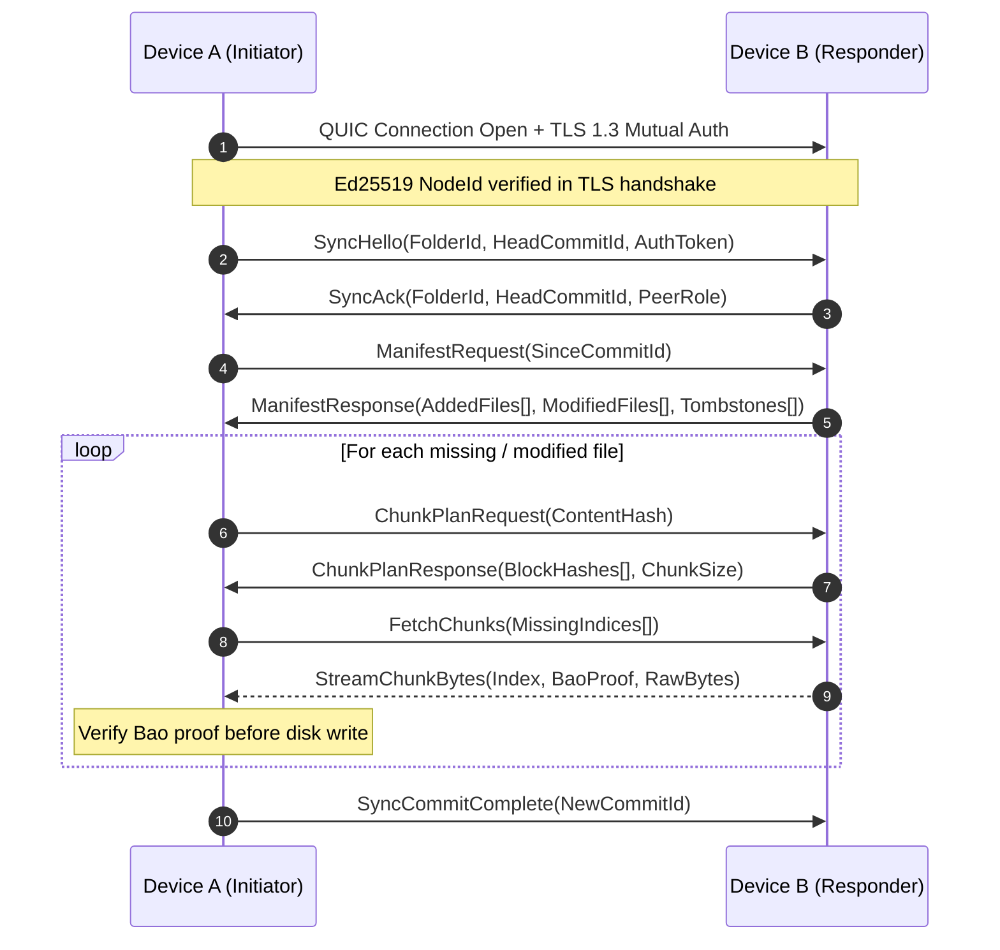

# P2Pme Wire Protocol & Data Specification

## 1. Node Identity & Addressing

Each P2Pme node is identified by a 32-byte Ed25519 Public Key:

```text
NodeId: ed25519_pubkey (Base32 encoded, 52 characters)
Example: k3d2m4p9q7x8w2z1...
```

---

## 2. Pairing Ticket Specification

Pairing between two devices (via QR code, clipboard string, or deep link) uses a compact serialized ticket:

```json
{
  "version": 1,
  "node_id": "z4k8...public_key",
  "folder_id": "uuid4_folder_identifier",
  "access": "read_write",
  "direct_addresses": [
    "192.168.1.50:11223",
    "203.0.113.195:45210"
  ],
  "relay_url": "https://relay.p2pme.net/derp",
  "auth_token": "hmac_sha256_shared_secret",
  "expires_at": 1795000000
}
```

* `access`: `"read_write"` or `"read_only"`.
* `direct_addresses`: Discovered LAN and STUN public socket candidates.
* `auth_token`: Ephemeral token for initial mutual handshake.

---

## 3. SQLite Local State Catalog Schema

```sql
PRAGMA journal_mode = WAL;
PRAGMA synchronous = NORMAL;

-- Tracked files in local managed folders
CREATE TABLE IF NOT EXISTS tracked_files (
    id INTEGER PRIMARY KEY AUTOINCREMENT,
    folder_id TEXT NOT NULL,
    relative_path TEXT NOT NULL,
    content_hash BLOB NOT NULL,
    file_size INTEGER NOT NULL,
    mtime_ns INTEGER NOT NULL,
    is_directory BOOLEAN NOT NULL DEFAULT 0,
    sync_status TEXT NOT NULL DEFAULT 'synced',
    updated_at INTEGER NOT NULL,
    UNIQUE(folder_id, relative_path)
);

-- Tombstones for deleted files (prevents resurrection across peers)
CREATE TABLE IF NOT EXISTS tombstones (
    folder_id TEXT NOT NULL,
    relative_path TEXT NOT NULL,
    deleted_hash BLOB NOT NULL,
    deleted_at INTEGER NOT NULL,
    deleted_by_node TEXT NOT NULL,
    PRIMARY KEY (folder_id, relative_path)
);

-- Content chunk manifest for delta replication
CREATE TABLE IF NOT EXISTS chunk_manifest (
    content_hash BLOB NOT NULL,
    chunk_index INTEGER NOT NULL,
    chunk_hash BLOB NOT NULL,
    offset INTEGER NOT NULL,
    length INTEGER NOT NULL,
    PRIMARY KEY (content_hash, chunk_index)
);

-- Connected peer registry
CREATE TABLE IF NOT EXISTS known_peers (
    node_id TEXT PRIMARY KEY,
    device_name TEXT NOT NULL,
    last_seen_address TEXT,
    last_handshake INTEGER,
    connection_type TEXT -- 'lan', 'wan_direct', 'relay'
);
```

---

## 4. Replication Session Handshake



---

## 5. Mobile Background Execution & Discovery Hardening

1. **Foreground Service & MulticastLock:** Uses Android `FOREGROUND_SERVICE_DATA_SYNC` with an ongoing system notification. In addition to a partial `WakeLock` and `WifiLock`, the service creates and acquires a `WifiManager.MulticastLock` with reference counting disabled. This prevents Linux kernel Wi-Fi driver packet filtering from dropping inbound UDP port 42424 discovery broadcasts while the phone screen is off.
2. **Wi-Fi SSID Filter:** Configurable setting to restrict heavy transfers only when connected to designated home/office SSIDs.
3. **Power Management:** Automatically pauses delta index hashing when battery drops below 20% unless plugged into AC power.

---

## 5.1. Persistent Connected Servers Registry & Subnet Sweep Protocol

### A. Connected Server Schema (`.connected_servers.json`)
The sender stores all paired servers in the persistent application documents sandbox:
```json
[
  {
    "id": "192.168.178.35:45455",
    "ip": "192.168.178.35",
    "port": 45455,
    "name": "OnePlus 6T (Hub)",
    "token": "0e853c5573aa1289...",
    "wanUrl": "http://100.85.12.44:45455",
    "lastSeen": "2026-11-18T22:15:00.000Z"
  }
]
```

### B. 3-Phase Reconnection Wire Protocol
When reconnecting or recovering from a home router DHCP IP shift:
1. **Phase 1 (Direct Probe):**
   ```http
   GET /api/info?key=0e853c5573aa... HTTP/1.1
   Host: 192.168.178.35:45455
   ```
   If HTTP 200 is returned, server is marked online immediately.
2. **Phase 2 (Subnet Sweep):**
   If Phase 1 fails (timeout/unreachable), the sender obtains its current local IP (e.g. `192.168.178.42`) and sweeps candidate host addresses `192.168.178.1` through `192.168.178.254` concurrently on port `45455` in batches of 25.
   Each candidate is probed with:
   ```http
   GET /api/info?key=0e853c5573aa... HTTP/1.1
   ```
   When a node responds with matching authentication and `node_id` or `device_name`, the client updates `server.ip = candidate_ip`, updates `lastSeen = DateTime.now()`, and immediately flushes the changes to `.connected_servers.json`.
3. **Phase 3 (Remote WAN / Mesh Fallback):**
   If local sweeps yield no response and `server.wanUrl` is configured (e.g., via Tailscale or DDNS), probes the WAN endpoint.
4. **Phase 4 (Zero-Config Global Cloudflare Tracker Resolution):**
   If neither local probes nor manual WAN succeed, the client computes `hub_id = sha256(server.authToken)` and queries the edge tracker:
   ```http
   GET /api/hub/resolve?hub_id=5f3d8a9e01bc... HTTP/1.1
   Host: p2pme.pages.dev
   ```
   When the tracker returns active coordinates, the client probes the resolved public IP/port directly and auto-binds the connection.

---

## 5.2. Cloudflare Zero-Knowledge Global Hub Tracker Wire Specification

### A. Hub Announcement (`POST /api/hub/announce`)
Every 5 minutes, an active Server Hub announces its coordinates to the Cloudflare edge:
```http
POST /api/hub/announce HTTP/1.1
Host: p2pme.pages.dev
Content-Type: application/json

{
  "hub_id": "5f3d8a9e01bc47a9821f009988aabbccddeeff00112233445566778899aabbcc",
  "public_ip": "93.184.216.34",
  "public_port": 45455,
  "local_ip": "192.168.178.35",
  "local_port": 45455,
  "device_name": "OnePlus 6T (Hub)",
  "upnp_active": true,
  "timestamp": 1795000000000
}
```
* **Zero Secret Leakage:** `hub_id` is derived via `sha256(secret_key)`. The plain secret key is **never** sent to the tracker.
* **Ephemeral TTL:** Announcements carry a strict 15-minute time-to-live (`expirationTtl: 900`). Stale records self-destruct automatically.

### B. Hub Resolution (`GET /api/hub/resolve?hub_id=<sha256>`)
When a remote sender device needs to locate its paired hub outside the home:
```http
GET /api/hub/resolve?hub_id=5f3d8a9e01bc47a9821f009988aabbccddeeff00112233445566778899aabbcc HTTP/1.1
Host: p2pme.pages.dev
```
Response:
```json
{
  "status": "active",
  "hub_id": "5f3d8a9e01bc47a9821f009988aabbccddeeff00112233445566778899aabbcc",
  "public_ip": "93.184.216.34",
  "public_port": 45455,
  "local_ip": "192.168.178.35",
  "local_port": 45455,
  "device_name": "OnePlus 6T (Hub)",
  "upnp_active": true,
  "updated_at": 1795000000000,
  "age_seconds": 45
}
```

---

## 6. Folder Lifecycle & Server Hub Routing

### A. Folder Removal / Detachment Semantics
* When a user removes a synchronized folder from Tab 2 (Backup), `P2PBridge.instance.stopWatcher(folderId)` cleanly releases native file watchers.
* **Disk Safety Guarantee:** Local files and directories are **never** deleted from disk when unlinking a folder.
* Paired nodes treat folder detachment as a clean peer unbind; tombstones are **not** broadcast, ensuring other devices also keep their copies intact.

### B. 24/7 Server Hub & Custom Destination
* When a device operates as a 24/7 Backup Server (Tab 3), it accepts incoming WebDrop uploads and continuous backup streams.
* Incoming payloads are routed to the user's custom `_receiveDestination` path (e.g., `/storage/emulated/0/Download/P2Pme` or a custom user-created directory), rather than an immutable root folder.
* Hub credentials (IP socket, 6-digit PIN, master secret key, and dynamic QR code) allow authorized devices to pair across LAN and WAN.

---

## 7. Dynamic Key & Ticket Wire Specification

### A. Server Hub Secret Wire Authentication
When connecting to a 24/7 Hub over HTTP or WebSockets:
```http
POST /upload?key=5f3d8a9e01bc47... HTTP/1.1
Host: 192.168.1.100:45455
X-P2Pme-Key: 5f3d8a9e01bc47...
Content-Type: multipart/form-data
```
* **Validation:** The server compares the supplied `key` parameter against its active in-memory and persistent secret `_hubSecretKey`.
* **Constant-Time Comparison:** Key verification uses constant-time byte comparisons to prevent timing side-channel attacks.
* **Revocation Response:** If the secret key does not match (or has been regenerated), the server immediately returns:
```json
HTTP/1.1 403 Forbidden
Content-Type: application/json

{
  "error": "Forbidden: Invalid or revoked server secret key",
  "code": "AUTH_REVOKED"
}
```

### C. QR Code Payload & Client Pairing Handshake
When scanned by the client camera in Tab 2 (Backup):
1. **Server QR Code Schema:**
```text
http://<host>:<port>?key=<256-bit_hex_token>[&wan=<remote_host>:<remote_port>]
```
* `<host>:<port>`: Primary local IP (LAN) or direct USB cable link-local IP (e.g. `192.168.1.100:45455` or `192.168.42.129:45455`).
* `key`: 256-bit CSPRNG authorization token required for all subsequent API and upload calls.
* `wan` *(optional)*: Public or Mesh WAN endpoint (e.g. Tailscale IP `100.x.y.z:45455` or public domain with port forwarding) enabling seamless cellular 5G/LTE failover.

2. **Client Parsing & Dual Socket Failover Sequence:**
   * Extracts LAN IPv4/domain address, port (defaults to 45455), `key` authorization token, and optional `wan` endpoint.
   * Dispatches initial handshake probe `GET /api/info` to the LAN address (4s timeout).
   * If LAN probe fails (e.g. peer is operating on cellular data), client automatically retries against the `wan` endpoint.
   * If server responds with valid P2Pme metadata (`"p2pme": true`), client marks the peer as `isPaired: true`, associates `authToken`, persists configuration to `.paired_server`, and triggers camera roll auto-backup.
   * In-flight socket failover: When uploading photos on the go, if the LAN socket aborts due to Wi-Fi disconnect, `CameraBackupService` seamlessly re-routes remaining pending assets to the secondary WAN socket.

### D. Boundless Asset Ingestion Semantics
* iOS PhotoKit (`PHFetchResult`) and Android MediaStore queries accept a scan limit parameter.
* When `limit <= 0`, queries run without arbitrary ceiling caps, allowing 100% of camera roll assets (e.g. 596+ photos) to be indexed and queued for synchronization.
* Photo uniqueness is validated via local SHA-256 / BLAKE3 cataloging to prevent duplicate re-transmission.

### B. Folder Pairing Ticket Serialization
Folder tickets are encoded as compact Base64-URL strings:
```text
p2pme://folder?v=1&node=<NODE_ID>&folder=<FOLDER_ID>&access=rw&token=<BLAKE3_HASH>&ts=<TIMESTAMP>
```
* `token`: Derived from `BLAKE3(SecretSeed || FolderID || TimestampNonce)`.
* `ts`: Generation epoch timestamp in seconds.
* Upon regeneration, the old `SecretSeed` nonce is replaced, immediately causing subsequent verification attempts with older tokens to fail.

---

## 8. Streaming Chunk & Throughput Telemetry Wire Sequence

For continuous file transfers, P2Pme uses streaming HTTP chunking with synchronized client-server throughput sampling and batch metadata headers:

```text
Sender (Client)                                          Receiver (24/7 Hub)
      |                                                         |
      | --- POST /upload?name=<file>&token=<key> -------------> |
      |     Headers: Content-Length, Content-Type: binary       | (Read Content-Length)
      |              X-Sender-Device-Name: iPhone 15 Pro        | (Extract Sender Device Name)
      |              X-File-Index: 12                           | (Extract File Index & Total)
      |              X-Total-Files: 596                         | 
      |              X-Batch-Total-Bytes: 5242880000            | (Extract Total Batch Size)
      |              X-Batch-Bytes-Sent: 1258291200             | (Extract Cumulative Sent)
      |                                                         |
      | === [Chunk 1: 64 KB] =================================> | (Write chunk to sink)
      | === [Chunk 2: 64 KB] =================================> | (Write chunk to sink)
      |     (Sample timer: 200ms -> calculate MB/s)             | (Sample timer: 200ms -> calculate MB/s)
      |     (Update Sender UI: Uploading 64.8 MB/s)             | (Update Receiver UI: Downloading 64.8 MB/s)
      |     (Batch: 1.25 GB / 5.00 GB • 25%)                    | (Batch: 1.25 GB / 5.00 GB • 25%)
      |     (File: 45% • 4.5 MB / 10.0 MB)                      | (File: 45% • 4.5 MB / 10.0 MB)
      | === [Chunk N: final] =================================> | (Finalize file, flush sink)
      |                                                         |
      | <--- HTTP/1.1 200 OK (Transfer Complete) -------------- |
```
* **Real-time Velocity:** Measured over 200–250ms delta windows using high-precision monotonic timers.
* **Batch Telemetry:** Both peers maintain synchronized batch progress in bytes and gigabytes so users know exact remaining data volume and completion percentages.
* **Symmetrical Telemetry Labels:** Senders explicitly display upload speed (`Uploading X MB/s`) and batch sent (`X MB sent of Y Total MB`); receivers explicitly display download speed (`Downloading X MB/s`) and batch received (`X MB received of Y Total MB`).
* **Pause Abort Semantics:** When the sender taps "Pause Backup", the client issues `request.abort()` or finishes the active chunk cleanly, stopping the stream without corrupting state. In Server Mode, pause controls are strictly restricted to the sender to prevent desynchronization.

---

## 9. Receiver Storage Telemetry & Out-of-Space Protocol (HTTP 507)

### A. Storage Exposure in Discovery Probe (`GET /api/info`)
Servers query native filesystem APIs (`StatFs` on Android, `resourceValues(forKeys: [.volumeAvailableCapacityForImportantUsageKey, .volumeTotalCapacityKey])` on iOS) and return real-time storage availability:
```json
{
  "p2pme": true,
  "device_name": "Pixel 7 Pro",
  "device_type": "android",
  "ip": "192.168.1.105",
  "port": 45455,
  "hub_configured": true,
  "storage": {
    "free_bytes": 45298483200,
    "total_bytes": 128000000000,
    "free_readable": "42.2 GB Free"
  }
}
```
* **Sender Pre-flight Warning:** If `batchTotalBytes > free_bytes`, the sender displays an amber alert chip warning that the receiver's disk capacity is lower than the queued batch size.
* **Zero Secret Leakage:** `hub_key_hint` has been eliminated; the endpoint only exposes a boolean `hub_configured`.

### B. Out-of-Space Negotiation Sequence (`HTTP 507 Insufficient Storage`)
When the receiver filesystem is exhausted or remaining space drops below buffer thresholds:
```text
Sender (Client)                                          Receiver (24/7 Hub)
      |                                                         |
      | --- POST /upload?name=<file>&token=<key> -------------> | (Pre-flight free space < 50 MB
      |                                                         |  OR FileSystemException ENOSPC)
      | <--- HTTP/1.1 507 Insufficient Storage ---------------- | (Clean up partial file)
      |      {"error":"STORAGE_FULL","message":"..."}           | (Show UI warning banner)
      |                                                         |
      | (Transition to CameraBackupState.serverStorageFull)     |
      | (Show UI: PAUSED (RECEIVER FULL))                       |
      | (Poll GET /api/info every 5 seconds, max 60 attempts)   |
      | --- GET /api/info ------------------------------------> | (User taps "Free up space" in
      | <--- 200 OK (storage.free_bytes: 42 GB) --------------- |  Google Photos on Receiver)
      |                                                         |
      | (Auto-Resume: re-issue POST /upload for failed file)    |
      | --- POST /upload?name=<file>&token=<key> -------------> |
```
* **Timeout Protection:** If storage is not freed within 5 minutes (60 poll cycles @ 5s), the client times out cleanly and surfaces a persistent error banner, preventing infinite polling loops.

---

## 10. Native Screenshot & Screen Recording Filtering & Configuration Persistence

* **Screenshot & Screen Recording Exclusion:** Native PhotoKit queries enforce `(mediaSubtype & (PHAssetMediaSubtype.photoScreenshot | PHAssetMediaSubtype.videoScreenRecording)) == 0`. Android filesystem scans filter out paths and filenames matching `*screenshot*` or `*screen_record*` / `*screenrecord*`.
* **Permanent Storage Persistence:** All synced asset indexes (`p2pme_synced_camera_assets.json`) and configuration profiles (`.p2pme_config.json`) are stored in `$HOME/Documents/` (iOS) and `/data/data/net.p2pme.p2pme_app/files/` (Android), which are protected from OS cache purges and survive app updates.

---

## 11. Dynamic Device Naming Across Platforms

* **Android Native:** Queries `Settings.Global.DEVICE_NAME` (API 25+) or falls back to `"${Build.MANUFACTURER} ${Build.MODEL}"`.
* **iOS Native:** Queries `UIDevice.current.name` (fallback `UIDevice.current.model`).
* **Desktop & Web:** Uses `COMPUTERNAME` / `localHostname` on Windows/Mac/Linux, and parsed platform user agent on Web PWA.
* **Header Propagation:** Senders pass `X-Sender-Device-Name` in every `/upload` call and UDP beacon so receivers display the genuine peer name.

---

## 12. Non-Destructive File Collision Resolution & Timestamp Suffix Protocol

* **Collision Trigger Condition:** When an HTTP `POST /upload?name=<filename>` or QUIC `DropRequestChunk` requests a file creation in destination folder $D$ where $D/<filename>$ already exists on disk.
* **Derived Path Formula:**
  $$\text{TargetName} = \text{stem}(filename) + \text{"_"} + \text{YYYYMMDD} + \text{"_"} + \text{HHMMSS} + \text{ext}(filename)$$
* **Monotonic Collision Counter:** If the derived timestamped filename also exists, an incremental counter suffix `_1`, `_2` is appended before the extension until a non-existent candidate path is found.
* **Audit Trail:** The receiver logs `[CollisionResolver] Filename collision detected for <orig> -> auto-renamed to <new>` and returns `200 OK` upon completion. The sender's ephemeral session completes normally.

---

## 13. Destination Folder Negotiation & External Provisioning Protocol

* **Configuration Schema (`.p2pme_config.json`):**
  ```json
  {
    "version": "1.2.2",
    "customDeviceName": "Living Room Hub",
    "receiveDestination": "/storage/emulated/0/Download/P2Pme",
    "isDefaultDestinationSet": true,
    "wifiOnlySync": true,
    "backgroundSyncEnabled": true,
    "rememberRole": true,
    "savedRole": "receiver",
    "folders": []
  }
  ```
* **Discovery Protocol Precedence:** On Android, the engine inspects internal documents storage first; if missing or if an external configuration is detected at `/storage/emulated/0/Download/P2Pme/.p2pme_config.json`, the external provisioning profile is loaded, and the UI immediately triggers a reactive state transition.

---

## 14. Multi-Stream Ingestion Session Protocol (ActiveReceiverSession)

* **HTTP Ingestion Headers:**
  * `X-Session-Token`: 128-bit session token or 256-bit server hub master secret.
  * `X-Sender-Name`: Dynamic hardware device name of the transmitter.
  * `X-File-Index`: Monotonically increasing zero-indexed file counter.
  * `X-Total-Files`: Total number of assets in the current transfer batch.
* **Session Lifecycle:** Sessions are instantiated upon first chunk arrival, updated every 250ms with smoothed byte deltas, and automatically pruned upon socket close or `DropComplete` frame.

---

## 15. Battery Level & Power State Protocol

* **Native Query Signature:**
  ```dart
  Future<Map<String, dynamic>> getBatteryStatus();
  // Returns: { "capacity": int (0-100), "is_charging": bool }
  ```
* **Enforcement Rule:** If `capacity < 15 && !is_charging`, `_triggerAutoCameraBackup()` returns immediately without scanning DCIM/PhotoKit libraries, mitigating power collapse.
